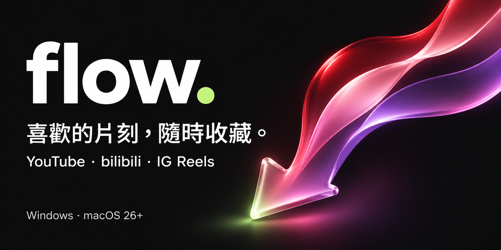
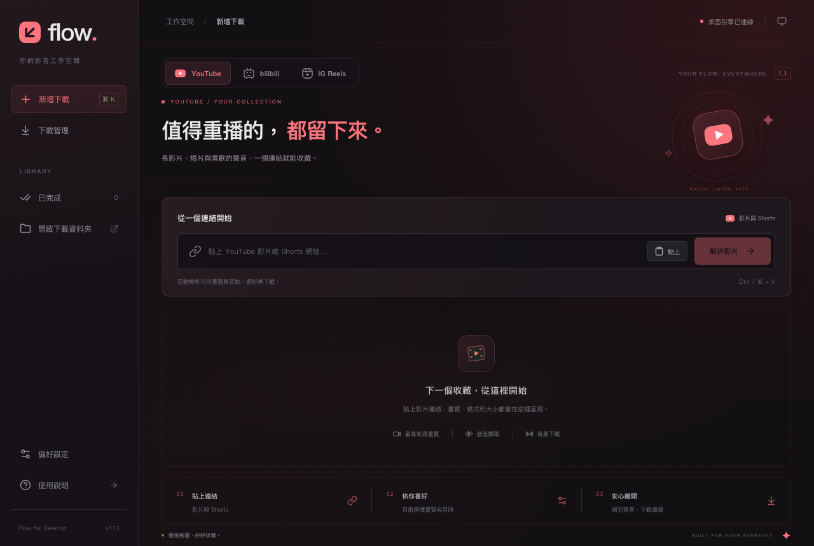
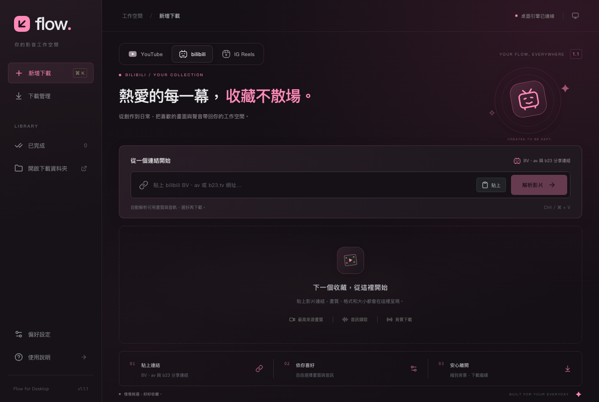
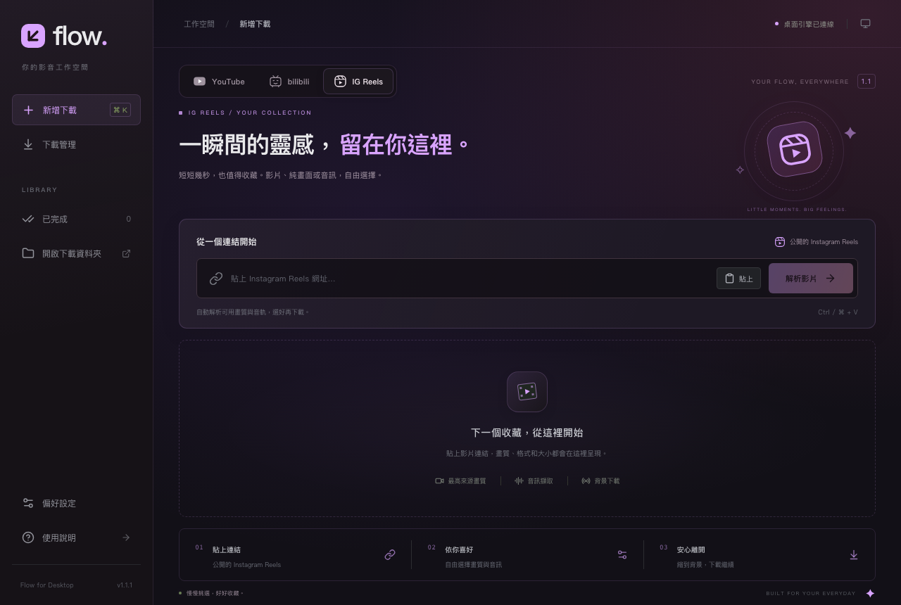

  

<h1 align="center">Flow</h1>

<strong>你的影音收藏工作空間。</strong> 一個連結，留下完整影片，或是那段想重播的聲音。

---

## 喜歡的內容，用自己的方式收藏

Flow 是一款支援 **YouTube／Shorts、bilibili 與 IG Reels** 的桌面影音下載工具。貼上影片連結，就能依來源選擇畫質，將喜歡的畫面與聲音儲存在自己的電腦。

安裝後即可開始使用，不需要設定 API Key，也不需要另外安裝下載或轉檔工具。

## 想留下什麼，由你決定

- **完整影片**：畫面與聲音，一起保存。
- **僅影片**：只留下畫面，不包含音軌。
- **僅音訊**：把喜歡的聲音帶著走，可選原始音訊、M4A 或 MP3。

來源只有影音合一檔案時，Flow 會自動分離畫面與聲音。可用畫質與音軌依影片來源提供，收藏方式由你選擇。

## 三個平台，三種氛圍

切換平台時，背景、圖示與操作配色會一起變換。直接貼上其他平台的影片連結，也能自動切換到對應主題。

### YouTube · 紅色主題

長影片、Shorts 與喜歡的聲音，值得重播的都留下來。

### bilibili · 粉紅色主題

從創作到日常，把熱愛的每一幕帶回自己的收藏。支援 BV、av、分 P 與 b23 分享連結，也能直接辨識包含標題的分享文字。

### IG Reels · 紫粉漸層

短短幾秒，也值得收藏。將公開可存取的 Reels，留下為影片、純畫面或音訊。

## 讓下載，融入你的日常

- **操作一眼可見**：固定介面讓畫質、格式與下載按鈕留在視窗內，不需捲動整頁尋找。
- **背景繼續下載**：關閉視窗時，可以選擇在背景繼續，讓收藏慢慢完成。
- **清楚管理進度**：查看下載狀態、取消、重試，或開啟完成檔案的位置。
- **內建自動更新**：從 GitHub Releases 取得新版，保留個人設定與下載紀錄。
- **跨平台使用**：支援 Windows x64 與 macOS 26 以上，提供 Apple Silicon、Intel 版本。

Flow 支援公開、可直接存取的單支影片；實際可用內容與畫質依來源平台提供。

---

<strong>Flow · 慢慢挑選，好好收藏。</strong>

